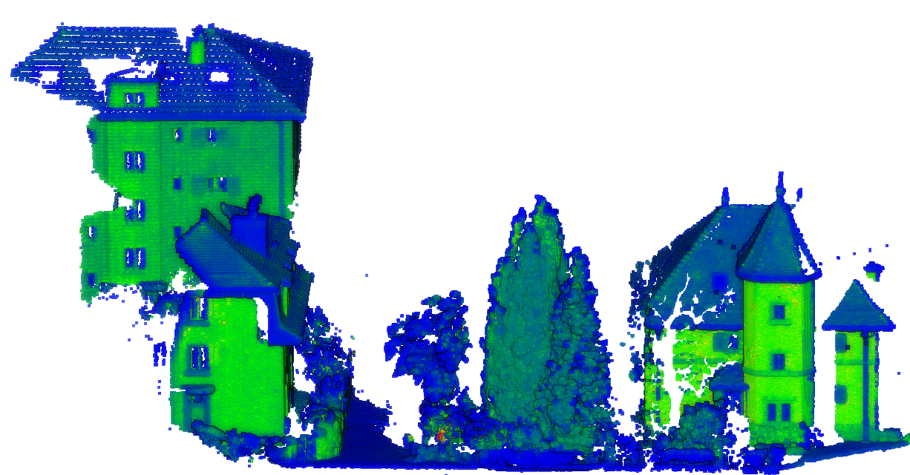
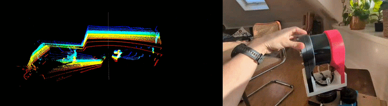
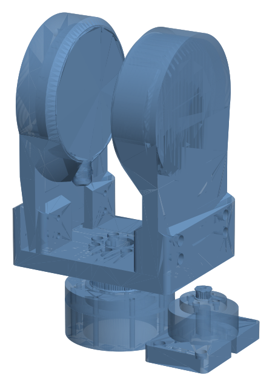

# low-cost-3d-scanner

Low-cost terrestrial 3D scanner: Hesai Pandar 40P LiDAR mounted on a SimpleFOC-driven gimbal motor (GM5208).





## CAD

The mechanical assembly is available in [`CAD/system.stl`](CAD/system.stl) (GitHub renders it as an interactive 3D view).

<p align="center">
  
</p>

## Structure

```
app/            GUI (PySide6) — scan, calibration, live 3D view
motor/          ESP32 firmware (SimpleFOC) + upload script
calibration/    Mount calibration scripts (5 methods)
record_lidar.py Static LiDAR capture → PCD
scan_lidar.py   3D scan with motor rotation → PCD
replay_scan.py  Replay PCAP → PCD
```

## Quick start

Dependencies are managed with [uv](https://docs.astral.sh/uv/) (`pyproject.toml` + `uv.lock`).

```bash
# Install uv (once)
curl -LsSf https://astral.sh/uv/install.sh | sh

# Create .venv and install the locked dependencies
uv sync

# Launch GUI
uv run app/main.py

# Or run a scan from CLI
uv run scan_lidar.py -d 60 --rpm 0.5 --return-rpm 4 -o scan.pcd
```

`uv run` syncs the environment automatically, so `uv sync` is optional. To add a dependency, use `uv add <package>` and commit the updated `pyproject.toml` and `uv.lock`.

## Hardware

- **LiDAR**: Hesai Pandar 40P (IP 192.168.20.13, UDP 2368)
- **Motor**: GM5208 gimbal BLDC (7 pole pairs) + AS5048A encoder
- **MCU**: WEMOS D1 R32 (ESP32) + SimpleFOC Shield v3.2
- **Power**: 19V on shield screw terminal

## License

MIT
